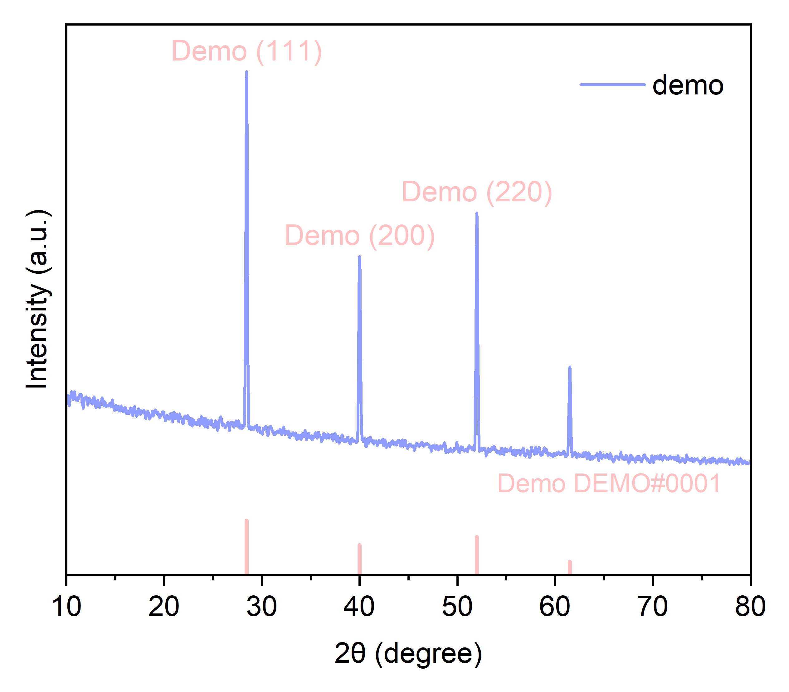

# xrd-plot

Draw publication-ready **stacked XRD figures** in Origin — sample pattern on top,
reference cards (PDF / JCPDS) as sticks at the bottom — driven from Python through
Origin's COM interface.



## Features

- **Peak finding** from plain two-column XRD text (Rigaku `.txt` with `[Data]` header, or any `2θ intensity` file)
- **Reference card library**: import cards straight from JADE `PDF#xxxx.txt` exports (no retyping peak lists), or compute a pattern from a COD CIF
- **Two-layer figure**: sample line on layer 1, card sticks on a linked child layer (X linked, Y independent)
- **Automatic labels**: hkl for the N strongest peaks (`Cu (111)`), coloured per phase, plus `Phase PDF#xx-xxxx` captions
- **Visual self-check** before export: every text object is verified not to sit on the curve or the axes
- **Deliverables**: 300 dpi TIF + `.opju` project, page size 8.43 × 7.40 in

## Requirements

| What | Why |
|---|---|
| **Windows** | Origin COM automation only exists on Windows |
| **OriginPro 2021 or newer, already running** | The scripts attach to your open Origin instance (`Origin.ApplicationSI`); nothing runs headless |
| **Python 3.10+** | tested on 3.14 |
| `numpy`, `scipy`, `pillow`, `pywin32` | peak finding, image probing, COM |
| *optional* `pymatgen` | only for `xrd_cards.py --from-cod` (pattern computed from a CIF) |
| *optional* JADE 6.5+ | to export reference cards as `PDF#xxxx.txt` |

```bash
pip install numpy scipy pillow pywin32
# optional
pip install pymatgen
```

## Quick start

```bash
# 1. what peaks does the pattern have?
python xrd_peaks.py examples/demo.txt

# 2. bring in a reference card (from a JADE export)
python xrd_cards.py --import "/path/to/PDF#05-0667.txt" --key Cu2O
python xrd_cards.py --list

# 3. draw it (Origin must be open)
python xrd_plot.py examples/demo.txt --cards Demo --smooth 15 --peaks 3
```

Output: `demo.tif` (300 dpi) and `demo.opju`, written next to the scripts and named
 after the input file.

### Common options

| Option | Meaning |
|---|---|
| `--cards NAME...` | one or more keys from `xrd_cards.json` |
| `--peaks N` | how many strongest peaks get an hkl label (default 3) |
| `--smooth N` | Savitzky-Golay window in points, `0` = raw (15 ≈ 0.3° is a good default) |
| `--card-y V` | Y range of the card layer; bigger = shorter sticks (default 1000 → sticks are 10 % of the frame) |
| `--x LO HI` | X range; **omitted = the measured range of the file** |
| `--no-labels` | no captions at all |
| `--force` | overwrite an existing `.opju` |

## How it works

```
raw txt ──xrd_peaks──► peak table (2θ, d, I/I0, FWHM)
                            │
xrd_cards.json ◄─xrd_cards──┤  JADE export / COD CIF
                            ▼
                       xrd_plot.py ──COM──► Origin ──► .tif + .opju
```

Layer 1 holds the sample (normalised 0–100, drawn between 28 and 128 on a 0–140 axis).
Layer 2 is a child layer with the reference sticks (Y 0–1000, so a 100 % card line is
10 % of the frame height). The child layer's X axis is linked to the parent, its Y axis
is independent, and its rectangle is `0/0/100/100` so it coincides with the parent frame.

## Card sources

- **JADE export (recommended)** — `PDF#xxxx.txt` files contain the card's own 2θ / d / I(f) / hkl.
  `xrd_cards.py --import` parses them and marks the entry `source: jade`.
- **COD (Crystallography Open Database)** — free CIFs, pattern computed with pymatgen.
  2θ matches a card to ~0.05°, but intensities are structure-factor values and can differ
  from a measured card by up to 2×. Good for phase identification, not for a citable card.
- Anything marked `source: memory` in the JSON was typed by hand and **should not be trusted** —
  `xrd_plot.py` prints a warning when it sees one.

The bundled `xrd_cards.json` only contains a synthetic demo phase, so the repository ships
no third-party card data.

## Notes and limitations

- Origin must be **open and idle**; modal dialogs block every COM call.
- The page size and layout are fixed (8.43 × 7.40 in). They were tuned for a two-column
  journal figure; change `PAGE_W`, `PAGE_H` and `LAYER` in `xrd_plot.py` if you need another size.
- `xrd_snapshot.py` dumps the current graph's style (axis ranges, fonts, colours, text positions)
  and can diff two snapshots — handy when you tweak the figure by hand and want the script to
  reproduce it later.
- The scripts carry Chinese comments; that is intentional (they grew out of a lab workflow).

## License

MIT — see [LICENSE](LICENSE).
